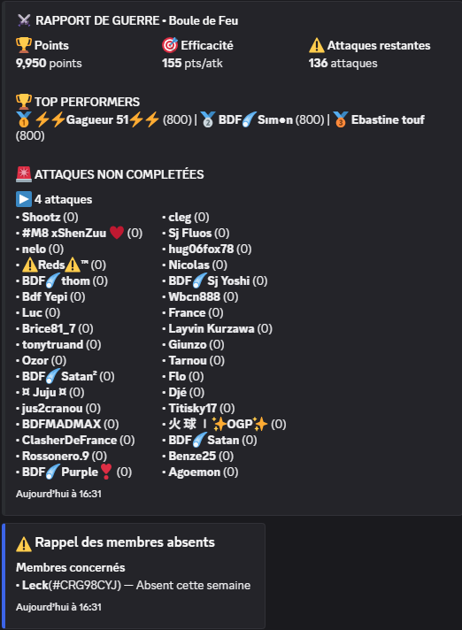
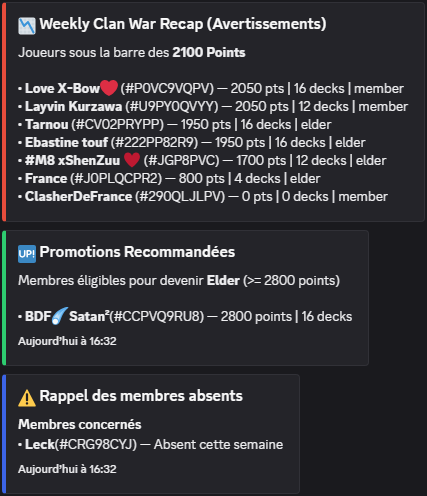
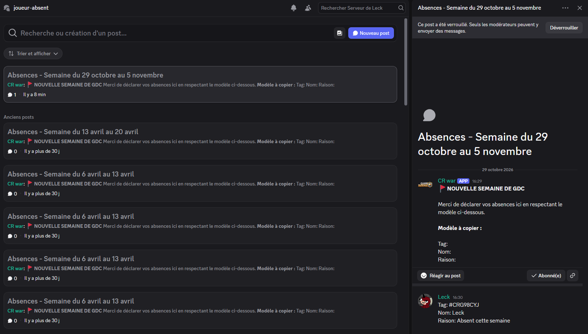

# Leck-warbot

Bot Discord en **Node.js** qui automatise le suivi des guerres de clan **Clash Royale** : rapport de guerre quotidien, bilan hebdomadaire des joueurs, recommandations de promotion et gestion des absences.


---

## Contexte

Dans un clan Clash Royale, les chefs doivent suivre chaque semaine la participation de dizaines de joueurs à la guerre de clan : qui a joué ses attaques, qui est sous l'objectif, qui mérite une promotion, qui est absent et pourquoi. Ce suivi se faisait à la main.

Ce bot récupère les données de l'API Clash Royale et publie automatiquement des rapports lisibles dans Discord. Il n'a besoin d'aucun serveur : il s'exécute à la demande via GitHub Actions, puis se déconnecte.

---

## Fonctionnalités

### Rapport de guerre quotidien (`bin/Daily.js`)

- Points du clan, **efficacité** (points par attaque) et nombre d'**attaques restantes**
- **Top 3** des joueurs
- Joueurs n'ayant pas terminé leurs 4 attaques du jour, regroupés par nombre d'attaques manquantes
- Gestion des deux types de période : jours de guerre classiques et **colisée**
- Les joueurs ayant quitté le clan sont écartés du rapport

<!-- 📸 CAPTURE 1 : rapport de guerre quotidien
<!--  -->

### Bilan hebdomadaire (`bin/Weekly.js`)

- **Avertissements** : joueurs sous un seuil de points, avec decks joués et rôle
- **Promotions recommandées** : membres (rôle `member`) atteignant le seuil pour devenir Elder
- **Rappel des absences** déclarées pour la semaine
- Les deux seuils sont **configurables** par variables d'environnement, sans toucher au code

<!-- 📸 CAPTURE 2 : bilan hebdomadaire (Avertissements / Promotions / Membres absents)
<!--  -->

### Gestion automatique des absences

Chaque semaine, le bot :

1. lit le fil d'absences en cours dans un salon **forum** Discord et en extrait les déclarations (`Tag`, `Nom`, `Raison`) par expressions régulières ;
2. publie le rappel des absents dans le bilan ;
3. **archive et verrouille** l'ancien fil ;
4. **crée le fil de la nouvelle semaine** avec le modèle à copier.

<!-- 📸 CAPTURE 3 : fils d'absences hebdomadaires dans le forum Discord
<!--  -->

---

## Stack technique

| Élément                   | Usage                                                        |
| ------------------------- | ------------------------------------------------------------ |
| **Node.js 20** (CommonJS) | Environnement d'exécution                                    |
| **discord.js v14**        | Embeds, salons forum, création et archivage de fils          |
| **axios**                 | Appels HTTP vers l'API Clash Royale (via le proxy RoyaleAPI) |
| **dotenv**                | Configuration locale via un fichier `.env`                   |
| **GitHub Actions**        | Exécution automatisée des scripts                            |

---

## Architecture

```
Leck-warbot/
├── .github/workflows/
│   ├── daily.yaml          # Déclenche bin/Daily.js
│   └── weekly.yaml         # Déclenche bin/Weekly.js
├── api/
│   └── ClashApi.js         # Client de l'API Clash Royale
├── bin/
│   ├── Daily.js            # Point d'entrée : rapport quotidien
│   └── Weekly.js           # Point d'entrée : bilan hebdomadaire
├── discord/
│   ├── DiscordConnection.js  # Connexion / déconnexion du bot
│   ├── DiscordMessage.js     # Construction et envoi des embeds
│   └── Discord.js            # Fils d'absences (lecture, création, archivage)
└── package.json
```

Le code est séparé en couches : les scripts `bin/` orchestrent, `api/` récupère les données du jeu, `discord/` s'occupe de tout ce qui touche à Discord. Chaque classe a une seule responsabilité.

**Endpoints utilisés** : `currentriverrace` (guerre en cours), `riverracelog` (dernière guerre terminée) et `members` (membres actuels et rôles).

---

## Installation

### Prérequis

- Node.js 20 ou supérieur
- Un bot Discord créé sur le [portail développeur Discord](https://discord.com/developers/applications), invité sur votre serveur, avec l'intent privilégié **Message Content** activé
- Une clé d'API générée sur [developer.clashroyale.com](https://developer.clashroyale.com) (le projet passe par le proxy [RoyaleAPI](https://docs.royaleapi.com/proxy.html), qui évite de devoir déclarer une IP fixe)

### Étapes

```bash
git clone https://github.com/LeckDev/Leck-warbot.git
cd Leck-warbot
npm install
```

Crée un fichier `.env` à la racine (voir `.env.example`) :

```env
DISCORD_TOKEN=token_du_bot_discord
CLASH_API_TOKEN=cle_api_clash_royale
CLAN_TAG=%23XXXXXXXX
REPORT_CHANNEL_ID=id_du_salon_des_rapports
ABSENTS_CHANNEL_ID=id_du_salon_forum_des_absences
DEMOTE_POINTS=2100
PROMOTE_POINTS=2800
```

> Le tag du clan est écrit avec `%23` à la place du `#` pour être utilisable dans l'URL de l'API.
> Le fichier `.env` est exclu par le `.gitignore` : ne le versionne jamais.

### Lancement

```bash
node bin/Daily.js    # rapport quotidien
node bin/Weekly.js   # bilan hebdomadaire + rotation du fil d'absences
```

---

## Automatisation

Les deux workflows GitHub Actions (`daily.yaml` et `weekly.yaml`) se déclenchent :

- par un **signal externe** (`repository_dispatch`, événements `daily_recap` et `weekly_recap`), ce qui permet de choisir librement l'outil et l'horaire de planification ;
- ou **manuellement** depuis l'onglet _Actions_ (`workflow_dispatch`).

Les variables sensibles sont stockées dans les **Secrets** du dépôt, jamais dans le code.

---

## Ce que ce projet m'a appris

- Consommer une **API REST** tierce avec authentification, et transformer des données brutes en indicateurs (efficacité, attaques restantes, éligibilité aux promotions)
- Construire un bot **discord.js** : embeds, salons forum, fils de discussion, intents
- Automatiser des traitements avec **GitHub Actions** et gérer des secrets
- Structurer un projet en couches pour garder un code lisible

---

## Pistes d'amélioration

- Ajouter des tests automatisés
- Historiser les performances pour suivre l'évolution des joueurs dans le temps
- Renforcer la gestion d'erreurs (cas où l'API ou Discord ne répond pas)

---

## Auteur

**Thomas Arnaud** : [GitHub](https://github.com/LeckDev) · [LinkedIn](https://www.linkedin.com/in/thomas-arnaud-dev/)

## Licence

ISC
